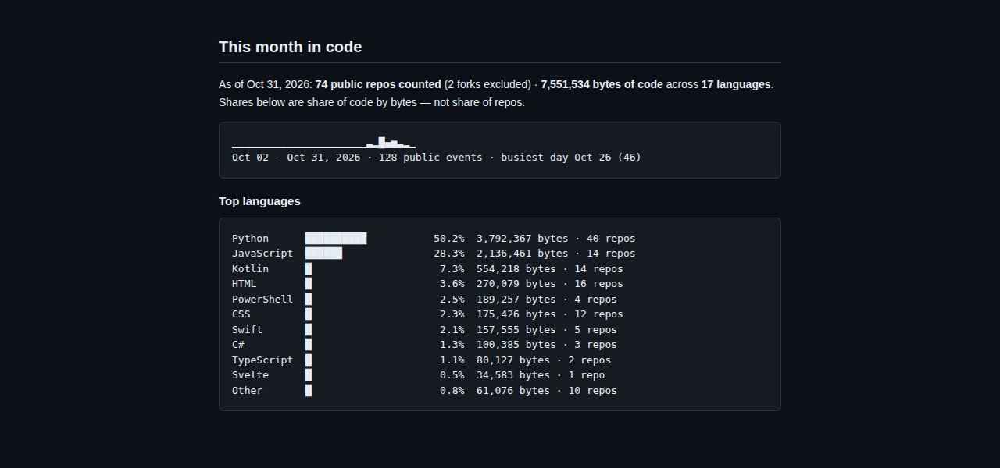
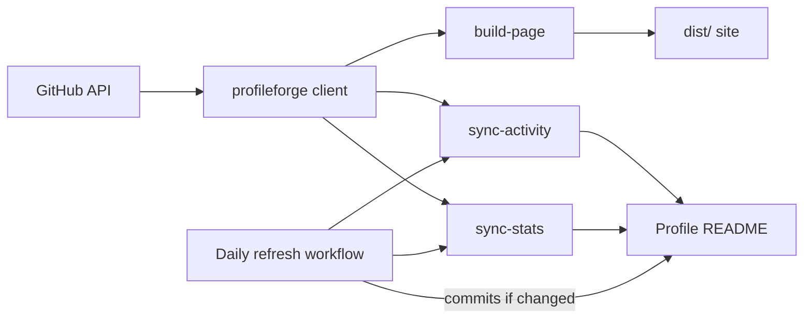
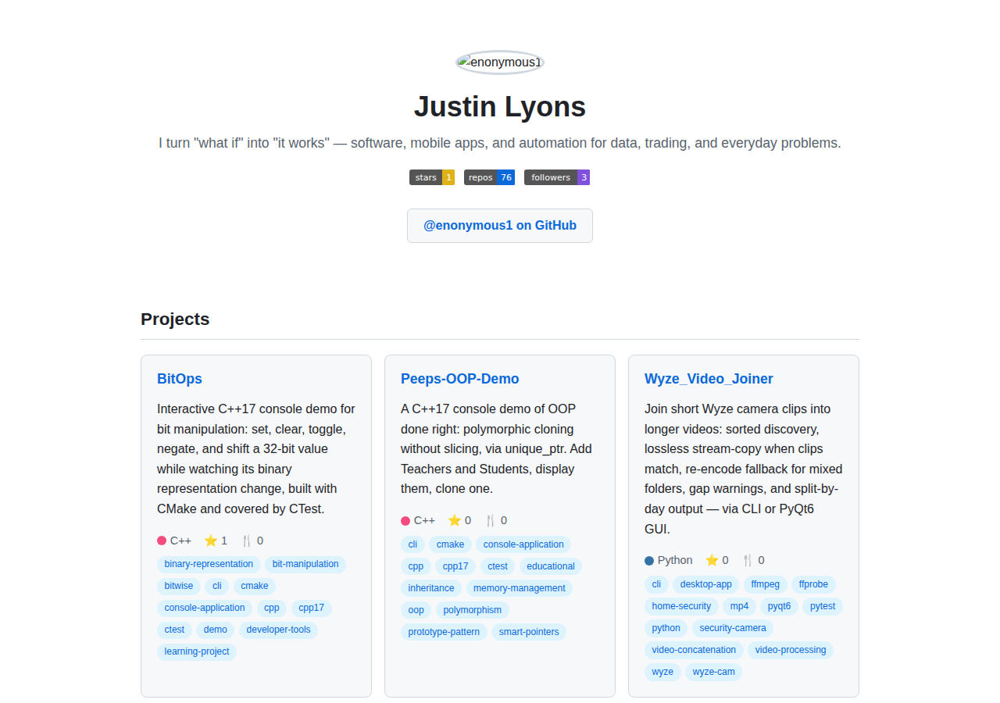
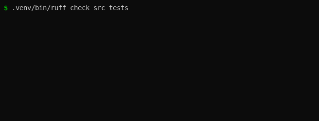

# profileforge


Tooling that keeps a GitHub profile alive from live data: it syncs recent
activity and code-share stats into the profile README, exports Python
sources to Markdown docs, and builds a static portfolio site from the same
pipeline. Typed, CI-gated, 244 tests, zero third-party stat services.

## Description

`profileforge` is a command-line tool for people who want their GitHub
profile to maintain itself. Point it at a username and it:

- **Syncs recent activity** into the profile README's activity section
  (`sync-activity`) — pushes, new repos, forks, issues, PRs, and releases,
  newest first, with push events collapsed to one line per repo and branch.
- **Syncs code-share stats** into the stats section (`sync-stats`) — a
  plain-text activity sparkline plus top languages ranked by share of code
  *bytes* (not share of repos), fetched per repo from the GitHub API.
  Plain text is deliberate: GitHub strips inline SVG and styled HTML from
  READMEs, so the section is fenced code blocks that always render.
- **Exports Python sources to Markdown** (`export-docs`) — a
  project-structure page plus one document per directory (rollup) or per
  file (mirror).
- **Builds a portfolio site** (`build-page`) — a responsive, dark/light
  aware static page with project cards, language stats, activity, a
  sparkline, and locally generated SVG badges, plus a `profile.json` data
  file. No third-party image services anywhere: every badge and chart is
  generated locally.


*The stats section from the live profile README — content verbatim,
rendered in GitHub's dark style.*

### How it works



One resilient client (retries with backoff, rate-limit waits, ETag
conditional requests) feeds three outputs, so the README and the portfolio
site can never disagree. Library code raises typed exceptions; only the
CLI decides exit codes. Everything is covered by tests (244 tests, 95.2%
coverage) with ruff, ruff-format, and mypy-strict enforced in CI.

## Prerequisites

- **Python 3.11 or newer** (`python --version` to check).
- **git**, for cloning and for the deployment steps below.
- **A GitHub account.** The tool reads public data, so most commands work
  without authentication — with two exceptions:
  - `sync-stats` and `render-readme` **require** `GITHUB_TOKEN`: they fetch
    language data for every repo, which exhausts the anonymous rate limit
    (60 requests/hour) almost immediately. With a token the limit is 5,000
    requests/hour.
  - The scheduled refresh workflow requires a separate `PROFILE_PAT`
    secret (see Deployment) because `GITHUB_TOKEN` cannot push to a
    different repository.

## Installation

There is no PyPI package yet — install from source.

**Just want the binary:**

```bash
pipx install git+https://github.com/enonymous1/profileforge.git
```

**Or a local checkout:**

```bash
git clone https://github.com/enonymous1/profileforge.git
cd profileforge
python -m venv .venv
source .venv/bin/activate        # Windows: .venv\Scripts\activate
pip install .                    # user install
```

**For development** (linters, type checker, tests):

```bash
pip install -e ".[dev]"
```

Then copy the example environment file and set your username:

```bash
cp .env.example .env             # then set GH_USERNAME (and GITHUB_TOKEN)
profileforge config-show         # validates settings, prints effective config
profileforge --help
```

`python -m profileforge` works too.

## Usage

```bash
profileforge version                             # print version
profileforge config-show                         # validated settings, secrets masked

profileforge sync-activity --dry-run             # preview the activity update
profileforge sync-activity                       # fetch events, update the README
profileforge sync-activity --username octocat --target path/to/README.md --max-lines 10

profileforge sync-stats --dry-run                # preview the stats section
profileforge sync-stats                          # update the stats section
profileforge sync-stats --sparkline-days 30      # trailing days in the sparkline

profileforge render-readme                       # full README template to stdout
profileforge render-readme -o README.md          # ...or write it to a file

profileforge export-docs ./src --dest ./docs-export
profileforge export-docs ./src --no-rollup       # one document per file instead of per directory

profileforge build-page --output ./dist          # portfolio site
profileforge build-page --projects 8             # showcase up to 8 repos
```

`build-page` writes `index.html`, `profile.json`, `styles.css`, and
`badges/{stars,repos,followers}.svg` into the output directory.


*A real `build-page` output: project cards, language dots, and activity.*

### Configuration

All settings come from the environment (optionally via a `.env` file).
`GH_USERNAME` is required; everything else has a sane default. Run
`profileforge config-show` to see the effective configuration with secrets
masked.

| Variable | Default | Purpose |
| --- | --- | --- |
| `GH_USERNAME` | *(required)* | GitHub username whose profile is served |
| `GITHUB_TOKEN` | *(unset)* | Personal access token; required for `sync-stats`/`render-readme`, raises rate limits everywhere else |
| `TARGET_FILE` | `README.md` | README receiving the activity/stats sections |
| `MAX_LINES` | `5` | Max activity lines written to the README |
| `SPARKLINE_DAYS` | `30` | Trailing days covered by the activity sparkline |
| `EVENTS_PER_PAGE` | `50` | Events requested per GitHub API page |
| `GITHUB_API_BASE_URL` | `https://api.github.com` | API base URL (override for GitHub Enterprise Server) |
| `REQUEST_TIMEOUT` | `15` | Per-request timeout in seconds |
| `MAX_RETRIES` | `3` | Retries per request before giving up |
| `RATE_LIMIT_MAX_WAIT` | `300` | Longest to wait out a rate limit before failing |
| `EXCLUDED_DIRS` | `.venv,venv,env,__pycache__,.git,…` | Directory names skipped by `export-docs` |
| `ROLLUP_DIRS` | `true` | Roll each directory's files into one document |
| `LOG_LEVEL` | `INFO` | Console log level |
| `LOG_JSON` | `false` | Emit JSON log lines instead of human text |

## Local Development

```bash
python -m venv .venv
source .venv/bin/activate        # Windows: .venv\Scripts\activate
pip install -e ".[dev]"
pip install pre-commit && pre-commit install   # lint, format, types on every commit
```

Gate commands (all enforced by CI):

```bash
ruff check src tests
ruff format --check src tests
mypy src
pytest
pytest --cov=profileforge --cov-report=term-missing   # 90% coverage gate
```

Work read-only first. Every sync command has a `--dry-run` mode, and
`render-readme` prints to stdout by default — preview before writing:

```bash
profileforge sync-activity --dry-run
profileforge sync-stats --dry-run
profileforge render-readme | head -60
profileforge build-page --output dist-preview   # open dist-preview/index.html in a browser
```

Before syncing against a real profile README, trial-sync against a scratch
copy and review the diff — that diff is the review gate:

```bash
cp /path/to/profile/README.md /tmp/README-scratch.md
profileforge sync-activity --target /tmp/README-scratch.md
git diff --no-index /path/to/profile/README.md /tmp/README-scratch.md
```

Project layout:

```
src/profileforge/
├── cli.py              # typer CLI (all subcommands)
├── config.py           # validated, env-driven settings (single source of truth)
├── logging_config.py   # deterministic stdlib logging (console or JSON)
├── github/             # typed event models, formatter registry, resilient API client
├── readme/             # marker-section README updater (atomic writes, dry-run)
├── exporter/           # Python-source discovery, tree, and Markdown renderers
├── profile/            # stats, sparklines, shared snapshot fetch, Jinja2 README template
└── site/               # portfolio builder (templates, badges, profile.json)
```

See `docs/ARCHITECTURE.md` for module responsibilities and conventions.


*The gate commands on the real codebase: ruff, format check, mypy-strict,
and the full pytest suite — recorded, not staged.*

## Deployment

### Scheduled profile refresh (the daily workflow)

`.github/workflows/refresh-profile.yml` runs `sync-activity` and
`sync-stats` daily at 04:17 UTC against your `<user>/<user>` profile repo
and commits only if something changed. It needs a `PROFILE_PAT` secret
because `GITHUB_TOKEN` cannot push to a different repository.

Setup:

1. Create a personal access token (classic) with the `repo` scope:
   GitHub → Settings → Developer settings → Personal access tokens →
   Tokens (classic) → Generate new token (classic). Copy the token — it
   shows only once.
2. In this repo: Settings → Secrets and variables → Actions → New
   repository secret, name `PROFILE_PAT`, paste the token.
3. Make sure your profile README contains both marker sections:
   `<!--START_SECTION:activity--> … <!--END_SECTION:activity-->` and
   `<!--START_SECTION:stats--> … <!--END_SECTION:stats-->`
   (`profileforge render-readme` generates a starter with both.)
4. Prove it once by hand: Actions → Refresh profile → Run workflow. A
   green run should produce a `chore: refresh profile data [skip ci]`
   commit in your profile repo. After that the daily schedule runs itself.

Alternative: copy the workflow into your `<user>/<user>` repo, drop the
second checkout and `PROFILE_PAT`, and use `GITHUB_TOKEN` instead.

### Publishing the portfolio site

`.github/workflows/pages.yml` deploys the `build-page` output to GitHub
Pages on every push to `main` (and on manual dispatch). One-time setup:
repo Settings → Pages → Build and deployment → Source: GitHub Actions.
Until that is set, the workflow fails with a Pages configuration error —
that is a setup step, not a code problem. The live site lands at
`https://enonymous1.github.io/profileforge/`.

Manual alternative: `profileforge build-page --output ./dist`, then push
`dist/` to a `gh-pages` branch (or any static host) and enable Pages
from that branch.

### Releases

1. Bump `__version__` in `src/profileforge/__init__.py` (the single
   source of truth).
2. Add a CHANGELOG entry.
3. Tag `vX.Y.Z` and push the tag; create a GitHub Release from it.

## Troubleshooting

- **"sync-stats needs GITHUB_TOKEN"** — expected. Set a token in `.env`;
  anonymous requests are capped at 60/hour and one language request per
  repo burns through that immediately.
- **Rate-limit errors** — the client waits out rate limits up to
  `RATE_LIMIT_MAX_WAIT` (default 300 s) before failing. If you hit this
  often, set `GITHUB_TOKEN`; if you hit it with a token, something is
  making far more requests than a daily sync should.
- **"Start marker not found"** — the target README lacks the
  `<!--START_SECTION:activity-->` / `<!--START_SECTION:stats-->` marker
  pair. Generate a starter with `profileforge render-readme` or paste the
  markers into the section by hand.
- **Empty activity feed** — the events API only covers roughly the last
  90 days. No public events in that window means no lines, and the README
  is deliberately left untouched (a no-op, not an error).
- **Configuration errors** — run `profileforge config-show`. It validates
  everything and prints the effective config with secrets masked; a bad
  `GH_USERNAME`, log level, or token value fails here, not mid-sync.

## License

MIT — see `LICENSE`.
